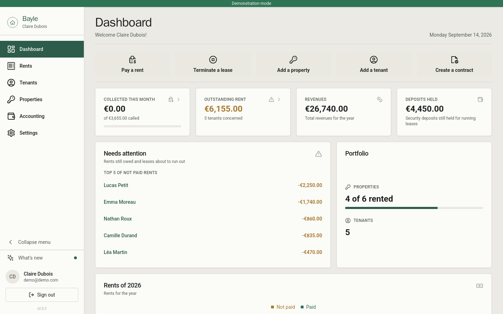
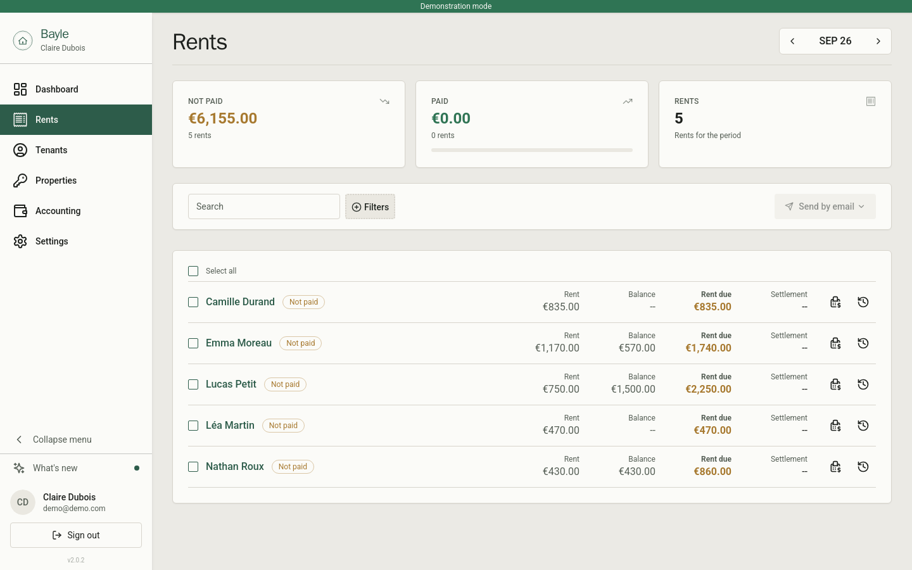
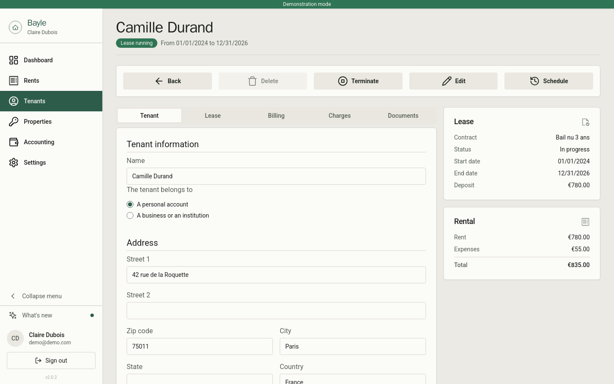
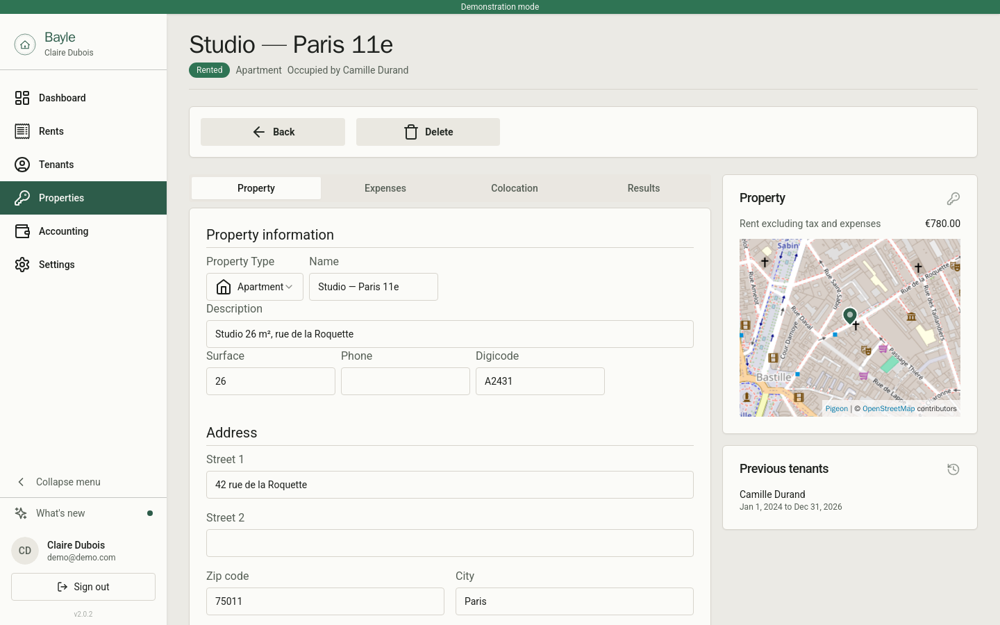
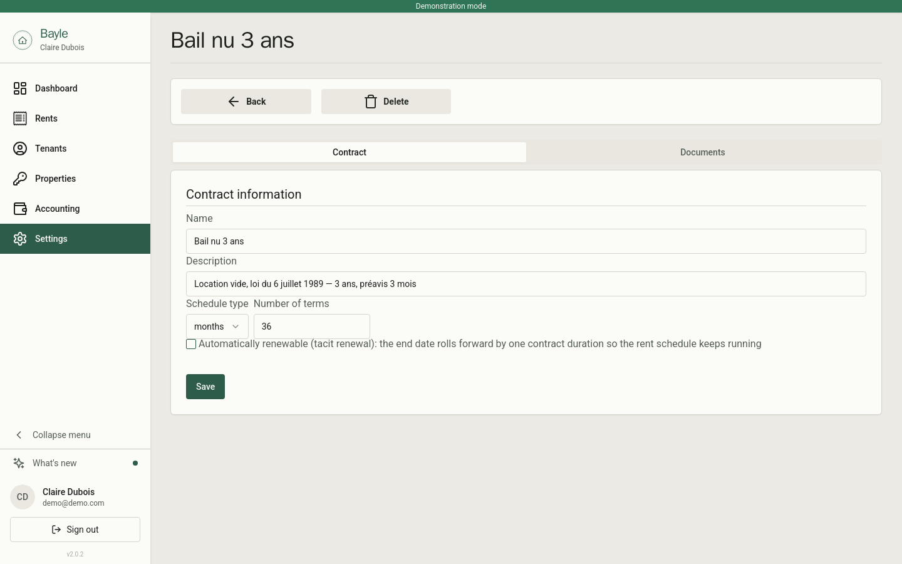

# Bayle

[](https://github.com/maellacour/bayle/actions/workflows/ci.yml)

Bayle is a free application for landlords. It keeps your properties, tenants, leases and rent payments in one place, so you always know who has paid, who is late and which lease is about to end. You install it on your own server, and your data stays with you.

> Bayle began as a fork of [MicroRealEstate](https://github.com/microrealestate/microrealestate) and has since diverged significantly. It remains free and open source under the MIT license. See [Credits and license](#credits-and-license).

[](./docs/pictures/overview.png)

## What you can do with it

- Follow the rents month by month: who paid, who is late and what is still owed.
- Record payments, then send receipts, rent calls and reminders by email.
- Keep a complete file per tenant: contacts, lease, deposit, documents and payment history.
- Describe each property once and track its occupancy and revenues over the years.
- Write your own contract templates and generate leases and letters from tenant data.
- Give tenants a portal where they check their lease and download their documents.
- Manage everything alone or invite collaborators into your organization.

Leases can renew automatically when they expire, rents can carry VAT and discounts, and the accounting pages give you the yearly figures you need for tax time.

## A quick look

The rents of the month, a tenant file, a property and a contract document being written.

<a href="./docs/pictures/rents.png"></a>
<a href="./docs/pictures/tenantcontract.png"></a>
<a href="./docs/pictures/property.png"></a>
<a href="./docs/pictures/contracttemplate.png"></a>

More screens are in the [pictures folder](./docs/pictures).

## How it runs

Bayle is a set of small services behind one entry point: a web application for the landlord, a portal for tenants, a REST API, a PDF generator and an emailer, with MongoDB and Redis for storage. Everything ships as Docker images and starts from a single compose file. The details are in the [developer documentation](./docs/DEVELOPER.md).

## Install it on your server

You need [Docker and Compose](https://docs.docker.com/compose/install) installed.

Download the compose file and the environment template:

```shell
mkdir bayle
cd bayle
curl https://raw.githubusercontent.com/maellacour/bayle/main/docker-compose.yml > docker-compose.yml
curl https://raw.githubusercontent.com/maellacour/bayle/main/.env.domain > .env
```

Open the `.env` file and fill in the secrets and tokens listed at the end of the file.

> **Upgrading from a previous installation?** Copy the secrets, the tokens and the `MONGO_URL` from your previous `.env` file into the new one. With different values the application cannot read the existing database and your credentials no longer work.

Then start the application in the way that fits your setup.

### On your machine

```shell
APP_PORT=8080 docker compose --profile local up
```

The application is served on http://localhost:8080/landlord and http://localhost:8080/tenant.

### On a server, reached by IP

```shell
sudo APP_DOMAIN=x.x.x.x docker compose up
```

Replace `x.x.x.x` with the address of the server. The application is served on http://x.x.x.x/landlord and http://x.x.x.x/tenant. If you need a specific port, set `APP_PORT` rather than adding the port to `APP_DOMAIN`.

### On a domain, with https

```shell
sudo APP_DOMAIN=app.example.com APP_PROTOCOL=https docker compose up
```

Point your DNS records to the server first. The SSL certificate is issued automatically, and the application is served on https://app.example.com/landlord and https://app.example.com/tenant.

## Back up and restore

Run these commands while the application is running, from the directory containing the compose file. They assume the default database name `mredb`; if you changed it in the `.env` file, adjust the commands.

Create a backup archive in the `backup` folder:

```shell
docker compose run mongo /usr/bin/mongodump --uri=mongodb://mongo/mredb --gzip --archive=./backup/mredb-$(date +%F_%T).dump
```

Restore one of the archives from the `backup` folder:

```shell
docker compose run mongo /usr/bin/mongorestore --uri=mongodb://mongo/mredb --drop --gzip --archive=./backup/mredb-XXXX.dump
```

Replace `mredb-XXXX.dump` with the name of the archive you want to restore.

## Development

To run the application in development mode and contribute, follow the [developer documentation](./docs/DEVELOPER.md).

## Credits and license

Bayle is a fork of [MicroRealEstate](https://github.com/microrealestate/microrealestate) by Camel Aissani and contributors, originally released under the MIT License. Bayle continues to be distributed under the MIT License, and the original copyright notice is preserved in [LICENSE](./LICENSE).

[MIT License](./LICENSE)
